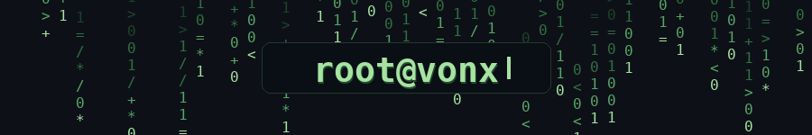
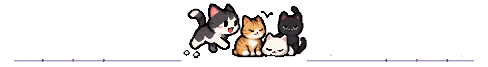
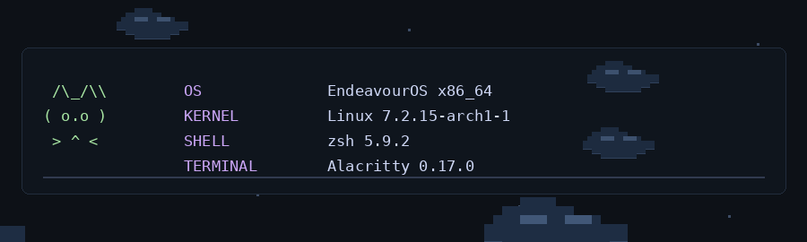

<h2>Welcome to my profile.</h2>

  

  <picture>
    <source
      media="(prefers-color-scheme: dark)"
      srcset="https://raw.githubusercontent.com/v0nx6/v0nx6/output/pacman-contribution-graph-dark.svg"
    />
    <source
      media="(prefers-color-scheme: light)"
      srcset="https://raw.githubusercontent.com/v0nx6/v0nx6/output/pacman-contribution-graph.svg"
    />
    
  </picture>

<h2 align="center">
  <code>root@vonxcc:~# echo "yesterday is history tomorrow is a mystery but today is a gift"</code>
</h2>

  

<table width="100%">
<tr>
<td width="50%" valign="top">

<h3><code>$ cat profile.json</code></h3>

<pre><code>{
  "about": "only student who are interest in becoming backend engginers and cyber security",
  "fun_fact": "i dont have a funfact 😹"
}</code></pre>

</td>
<td width="50%" valign="top">

<h3>Connect with me:</h3>

</td>
</tr>
</table>

<h3><code>$ fastfetch</code></h3>

  

<h3><code>$ ls languages-and-tools/</code></h3>

